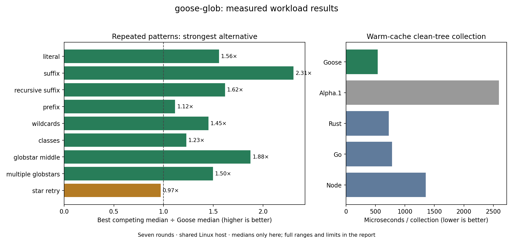

# Competitive results — 2026-11-06

Seven CPU-affined, shuffled rounds on a shared Linux x86-64 host. Lower is better.
Cells show median **[min, max]** nanoseconds per operation, or microseconds per collection.
The complete [raw report](raw.json) records every sample, source/tool/binary hashes and versions.
[Reproduction and scope](../../README.md). A lower median is not a statistical significance claim.

Measured source: `35687d4b673b564c472f0132ab6903bce72f30c2`. Original alpha source: `4e8d7830e81b8ffd1c4d8ae2716ea93edc7ea8e3`.
Published documentation may follow this measured source; the raw source hashes identify the exact matcher, collector and harness.
Goose GCC -O2; Rust globset 0.4.21 (matching)/glob 0.3.4 (collection); Go doublestar 4.10.4;
Node picomatch 4.0.7 (matching)/fast-glob 3.3.3 (collection). Compiler/runtime details are in the raw report.

Per round: 65,536 match calls per workload; Rust/Node one-shot compilation uses 2,048; 64 full collections.
The initial interrupted run was discarded for final claims after integrity review; final samples come from the strengthened guards.

## Repeated patterns

| Workload | Goose | Alpha.1 | Rust | Go | Node |
| --- | ---: | ---: | ---: | ---: | ---: |
| literal | 79.4 [78.2, 84.1] | 307.0 [296.0, 313.3] | 123.6 [116.3, 126.2] | 132.1 [128.3, 143.6] | 390.2 [339.7, 413.6] |
| suffix | 50.6 [47.3, 55.1] | 174.1 [162.8, 177.5] | 116.9 [112.5, 123.9] | 147.3 [136.5, 154.2] | 431.5 [359.1, 529.6] |
| recursive_suffix | 88.1 [80.7, 89.8] | 311.5 [307.8, 328.6] | 142.6 [137.8, 149.5] | 319.4 [310.5, 339.6] | 326.3 [174.2, 396.9] |
| prefix | 56.9 [51.4, 59.3] | 169.8 [166.3, 182.7] | 99.2 [96.6, 107.8] | 63.6 [60.9, 67.2] | 226.2 [219.5, 256.1] |
| wildcards | 108.6 [101.9, 114.2] | 312.4 [296.5, 319.9] | 157.6 [154.1, 170.5] | 164.4 [161.7, 178.3] | 247.6 [196.8, 364.2] |
| classes | 121.4 [115.7, 127.0] | 388.2 [379.7, 398.8] | 149.2 [144.8, 159.4] | 184.2 [171.1, 193.0] | 295.7 [134.0, 402.5] |
| globstar_middle | 105.3 [95.9, 108.9] | 429.5 [414.5, 436.4] | 197.6 [184.6, 211.7] | 205.0 [194.3, 214.9] | 347.5 [275.1, 405.6] |
| multiple_globstars | 137.1 [126.1, 141.3] | 481.0 [450.3, 494.2] | 205.3 [200.0, 210.1] | 227.1 [216.2, 246.8] | 240.4 [193.9, 257.8] |
| star_retry | 142.4 [133.2, 155.9] | 350.4 [311.2, 371.6] | 138.3 [136.2, 151.0] | 331.3 [312.3, 360.1] | 242948.4 [234476.7, 251157.9] |

Goose has the lower median in 8/9 versus Rust, 9/9 versus Go, 9/9 versus Node.

## Parse/validate on every call

| Workload | Goose | Alpha.1 | Rust | Go | Node |
| --- | ---: | ---: | ---: | ---: | ---: |
| literal | 192.5 [188.4, 201.9] | 307.5 [292.5, 322.8] | 21733.6 [20726.6, 22928.7] | 133.3 [131.0, 135.2] | 10009.7 [5309.8, 10757.7] |
| suffix | 103.4 [99.4, 108.1] | 171.6 [161.5, 185.5] | 19405.4 [18853.0, 20230.3] | 149.0 [139.5, 151.6] | 3538.6 [1586.6, 6069.7] |
| recursive_suffix | 144.0 [134.5, 154.7] | 312.0 [307.8, 339.6] | 27636.2 [26284.5, 28826.0] | 323.1 [310.3, 330.0] | 3547.1 [2597.8, 5292.9] |
| prefix | 117.6 [110.0, 124.3] | 167.1 [163.6, 190.3] | 19201.2 [18248.1, 20172.7] | 58.2 [55.1, 62.2] | 31068.7 [3205.2, 32649.3] |
| wildcards | 196.3 [190.6, 212.7] | 312.1 [278.4, 348.1] | 29736.0 [27887.0, 31205.5] | 164.0 [162.5, 171.1] | 34333.1 [8107.0, 40553.4] |
| classes | 262.9 [257.0, 286.3] | 388.0 [358.6, 435.6] | 30208.9 [27724.8, 30952.3] | 178.3 [171.0, 181.0] | 15804.8 [10568.7, 42863.5] |
| globstar_middle | 213.8 [209.4, 235.0] | 430.5 [429.6, 486.9] | 31942.8 [30228.9, 34788.3] | 196.8 [192.6, 204.6] | 29895.6 [8532.6, 34345.1] |
| multiple_globstars | 247.5 [246.0, 270.1] | 499.5 [482.0, 539.2] | 43092.4 [40409.1, 47877.3] | 219.9 [212.2, 236.7] | 21149.2 [12222.9, 42925.5] |
| star_retry | 192.1 [185.3, 212.3] | 362.9 [342.3, 386.4] | 29584.0 [28282.8, 31670.1] | 331.4 [301.5, 341.0] | 256704.1 [250912.8, 268845.3] |

Goose has the lower median in 9/9 versus Rust, 3/9 versus Go, 9/9 versus Node.

## Clean-tree collection

| Workload | Goose | Alpha.1 | Rust | Go | Node |
| --- | ---: | ---: | ---: | ---: | ---: |
| walk | 536.9 [519.2, 568.8] | 2594.8 [2491.0, 2770.7] | 727.0 [694.4, 766.1] | 781.4 [744.0, 827.3] | 1352.5 [1328.0, 1408.4] |

Goose has the lower median in 1/1 versus Rust, 1/1 versus Go, 1/1 versus Node.

[Vector chart](comparison.svg) · [Interactive chart source](comparison.html)

## Interpretation

Pattern reuse is the relevant mode for filtering many candidate files. One-shot Rust/Node figures include their normal compilation cost and must not be used alone to advertise an overall advantage.
Original Goose lacks a prepared API, so its repeated-pattern baseline retains its direct call. All candidates still receive the same runtime corpus and expected outcomes.
Collection uses a clean, warm-cache tree with identical normalized path sets. The libraries retain different metadata, validation, sorting and resource/error policies; this is throughput evidence for that tree only.
Slower results and wide ranges remain in the tables. Shared scheduling, power/thermal effects and corpus selection limit generalization; no peak-memory, cold-storage, security-equivalence or universal language-speed claim is established.
