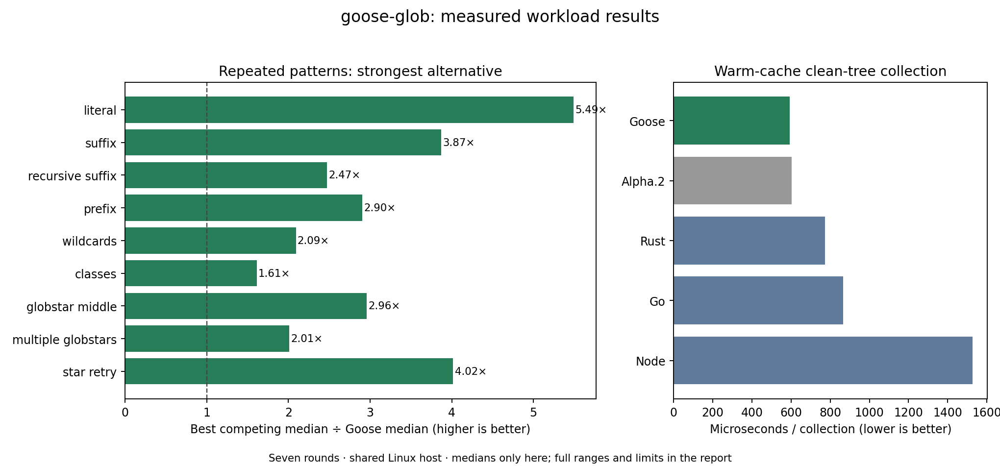

# Competitive results — 2026-11-07

Seven CPU-affined, shuffled rounds on a shared Linux x86-64 host. Lower is better.
Cells show median **[min, max]** nanoseconds per operation, or microseconds per collection.
The complete [raw report](raw.json) records every sample, source/tool/binary hashes and versions.
[Reproduction and scope](../../README.md). A lower median is not a statistical significance claim.

Measured source: `ef614ff58cdd2fb6bf508e80fa83aa8e51e1e19b`. Previous release source: `bbca475ea39b5ea86b77acf9f4a85ef36d77d6e0`.
Published documentation may follow this measured source; the raw source hashes identify the exact matcher, collector and harness.
Goose GCC -O2; Rust globset 0.4.21 (matching)/glob 0.3.4 (collection); Go doublestar 4.10.4;
Node picomatch 4.0.7 (matching)/fast-glob 3.3.3 (collection). Compiler/runtime details are in the raw report.

Per round: 65,536 match calls per workload; Rust/Node one-shot compilation uses 2,048; 64 full collections.
All final samples use the existing complete source, dependency, environment and fixture guards. The earlier published report remains historical.

## Repeated patterns

| Workload | Goose | Alpha.2 | Rust | Go | Node |
| --- | ---: | ---: | ---: | ---: | ---: |
| literal | 24.1 [23.3, 26.2] | 85.3 [83.9, 88.9] | 132.1 [124.5, 133.3] | 145.1 [142.1, 168.3] | 432.9 [410.2, 529.2] |
| suffix | 32.7 [32.4, 33.5] | 54.2 [51.4, 58.7] | 126.7 [121.5, 128.8] | 158.2 [156.8, 198.2] | 501.4 [455.2, 576.6] |
| recursive_suffix | 63.7 [61.2, 92.3] | 92.9 [87.4, 98.1] | 157.6 [150.5, 166.0] | 348.5 [342.3, 392.8] | 413.1 [377.8, 451.6] |
| prefix | 23.2 [22.0, 24.1] | 61.5 [61.0, 65.4] | 109.7 [106.4, 117.1] | 67.4 [66.1, 72.4] | 276.1 [254.1, 301.4] |
| wildcards | 85.4 [82.7, 89.5] | 115.6 [114.6, 116.7] | 178.6 [175.2, 187.1] | 178.7 [176.8, 194.9] | 379.1 [224.4, 451.4] |
| classes | 106.1 [101.8, 109.2] | 132.8 [128.3, 135.9] | 171.1 [166.0, 174.0] | 195.8 [190.0, 210.0] | 335.3 [147.3, 443.6] |
| globstar_middle | 74.8 [73.3, 77.7] | 112.0 [106.0, 119.6] | 221.4 [215.1, 236.3] | 223.6 [221.4, 233.0] | 238.1 [191.2, 392.6] |
| multiple_globstars | 111.3 [107.8, 114.9] | 148.9 [147.6, 155.8] | 223.7 [213.7, 255.5] | 249.0 [244.7, 257.2] | 228.8 [175.7, 424.0] |
| star_retry | 39.7 [38.8, 41.5] | 158.9 [154.9, 168.9] | 159.4 [153.5, 170.7] | 376.1 [366.9, 402.8] | 270610.7 [269417.4, 301844.4] |

Goose has the lower median in 9/9 versus Rust, 9/9 versus Go, 9/9 versus Node.

## Parse/validate on every call

| Workload | Goose | Alpha.2 | Rust | Go | Node |
| --- | ---: | ---: | ---: | ---: | ---: |
| literal | 66.2 [63.8, 70.1] | 204.8 [201.8, 246.5] | 23587.9 [22986.0, 25191.5] | 144.0 [142.5, 177.8] | 11134.9 [9969.0, 11832.2] |
| suffix | 42.7 [40.6, 44.1] | 117.3 [107.2, 123.6] | 21491.5 [20992.6, 22156.1] | 158.3 [154.6, 186.7] | 3697.4 [2572.1, 4943.3] |
| recursive_suffix | 91.7 [89.7, 97.0] | 158.5 [149.5, 162.2] | 31397.8 [29796.5, 33064.6] | 348.5 [342.7, 371.9] | 3785.9 [3597.3, 5268.5] |
| prefix | 37.0 [35.0, 39.7] | 127.4 [123.8, 134.8] | 21299.0 [20246.6, 22903.1] | 67.6 [66.5, 70.4] | 32887.7 [3339.0, 36244.0] |
| wildcards | 124.5 [121.5, 133.7] | 218.1 [212.5, 230.1] | 33565.5 [31667.0, 37354.6] | 182.2 [177.9, 188.1] | 11130.1 [6557.8, 41794.6] |
| classes | 155.5 [150.9, 160.3] | 292.4 [289.5, 313.7] | 34139.4 [32134.3, 36353.1] | 202.1 [191.1, 217.6] | 16319.2 [9703.8, 42229.1] |
| globstar_middle | 130.3 [125.7, 134.9] | 246.3 [229.8, 257.0] | 37005.4 [34222.9, 39888.6] | 225.1 [215.3, 233.6] | 32725.2 [9990.1, 36282.9] |
| multiple_globstars | 182.2 [174.7, 188.6] | 277.9 [266.5, 293.1] | 49156.4 [45781.0, 57808.2] | 247.3 [242.7, 257.0] | 30705.0 [25748.2, 32818.7] |
| star_retry | 68.0 [65.9, 74.7] | 219.8 [214.3, 225.0] | 32968.7 [31106.5, 36560.6] | 369.9 [367.9, 393.1] | 282467.6 [280128.7, 303554.8] |

Goose has the lower median in 9/9 versus Rust, 9/9 versus Go, 9/9 versus Node.

## Clean-tree collection

| Workload | Goose | Alpha.2 | Rust | Go | Node |
| --- | ---: | ---: | ---: | ---: | ---: |
| walk | 593.4 [574.7, 615.3] | 602.4 [596.5, 633.9] | 773.8 [763.1, 882.7] | 866.8 [849.9, 966.4] | 1527.1 [1477.9, 1591.3] |

Goose has the lower median in 1/1 versus Rust, 1/1 versus Go, 1/1 versus Node.

[Vector chart](comparison.svg) · [Interactive chart source](comparison.html)

## Interpretation

Pattern reuse is the relevant mode for filtering many candidate files. One-shot Rust/Node figures include their normal compilation cost and must not be used alone to advertise an overall advantage.
The alpha.2 reference uses its prepared API in repeated mode. All candidates receive the unchanged corpus and expected outcomes.
Collection uses a clean, warm-cache tree with identical normalized path sets. The libraries retain different metadata, validation, sorting and resource/error policies; this is throughput evidence for that tree only.
Slower results and wide ranges remain in the tables. Shared scheduling, power/thermal effects and corpus selection limit generalization; no peak-memory, cold-storage, security-equivalence or universal language-speed claim is established.

The alpha.2 reference uses the prepared API in its repeated-pattern row; its
baseline is not the older raw-call proxy. The matching corpus and competitor
versions are unchanged from the earlier report. Collection code is unchanged;
small alpha.2/alpha.3 collection differences are not an independent traversal
improvement claim. Model and compatibility tests cover behavior beyond this
ASCII timing corpus, including long cheap chunk misses and bounded searches.
